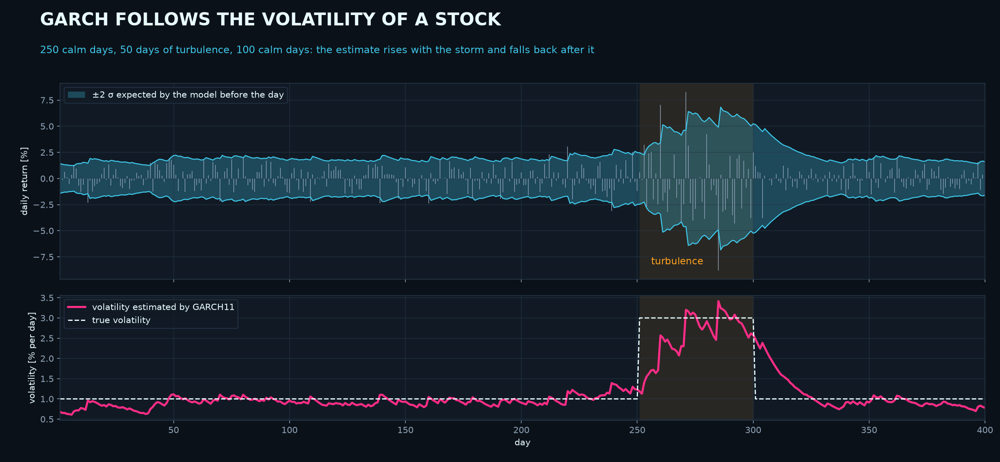
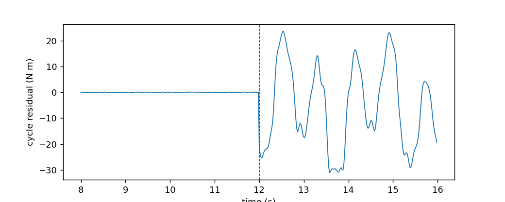

# Time series

A time series is a signal that arrives in order, one value after the other: the price of a stock, the reading of a sensor, a heartbeat, the torque of a robot joint. The tools in this section learn how the signal usually moves, so that they can predict the next value, follow a hidden state, or notice when the signal starts to behave differently. Like the rest of the library, they learn one sample at a time.

## The map of the time series

Click a page to open it, or a job on the left (or the button at the top) to go back to the [map of the library](../index.md#the-library-folder-by-folder).

<object type="image/svg+xml" data="../assets/maps/timeseries.svg" style="width:100%"></object>

## Gamestory

New Year's Eve in London. A mysterious thief is emptying the banks of the city.

So far the detectives were trying to guess which bank the thief would choose. Now instead a detective steps in who looks at the rhythm and time: he watches the thief's movements minute by minute to understand his pace and immediately notice if something strange happens.

To do this he has four quick tricks:

- **Guesses the next step** (`OnlineAR`): He looks at where the thief was one minute ago and two minutes ago, and immediately understands where he will put his foot in one second.
- **Sees through the fog** (Kalman Filter): Even if the cameras are blurry and the clues are confused, he manages to calculate exactly where the thief is and how fast he is running.
- **Breaks habits** (`CycleResidual`): If the night guard always does the same round every ten minutes, the detective memorizes the perfect rhythm. As soon as something breaks that rhythm, the alarm immediately goes off.
- **Feels when chaos rises** (GARCH): He understands on the fly if the night is calm and predictable or if panic is about to break out and all the clues go crazy.

## 1. A first example: the volatility of a stock

A fund wants to know how risky a stock is *today*. The size of the daily moves is not constant: there are calm periods and agitated ones, and the agitated ones come in clusters. `GARCH11` follows that size, called the volatility, one day at a time. Here there are 250 calm days (moves of about 1 %), 50 days of turbulence (about 3 %) and 100 calm days again.

```python
import numpy as np
from dense_armor.core.online.timeseries import GARCH11

rng = np.random.default_rng(0)
returns = np.concatenate([rng.normal(0.0, 0.01, 250), rng.normal(0.0, 0.03, 50), rng.normal(0.0, 0.01, 100)])
g = GARCH11(omega=1e-6, alpha=0.08, beta=0.90)
vol = []
for r in returns:
    g.learn_one({"x": float(r)})
    vol.append(g.sigma2_**0.5)
print([round(vol[i] * 100, 2) for i in (249, 299, 399)])
```

```
[1.23, 2.58, 0.78]
```



The estimated volatility is 1.2 % at day 250 (the true value is 1 %), 2.6 % at day 300, at the end of the turbulence (the true value is 3 %), and 0.8 % at day 400, after the calm has returned (1 %). The upper panel shows what the model expected before seeing each day, a band of two standard deviations: the first big days of the storm fall outside it, because the model can only learn from them after they happen, and then the band widens. Over the 400 days, 27 fall outside the band.

## 2. The four families

A **time-series estimator** is a model whose input is the recent past of a
signal and whose output is a prediction about the future, a residual, or a
smoothed reading. The four families differ in what they predict.

`OnlineAR` predicts the next value of one channel from its own last `order`
values. A joint torque that follows a periodic pattern is a sequence of AR
coefficients, and the model recovers them online. `OnlineVAR` is the same
idea for several channels at once; it predicts every channel from the recent
past of every channel, and a group-lasso penalty keeps the coefficients
sparse when only a few cross-channel relations matter.

`KalmanFilter` predicts the *state* of a system, not its next sample: a
position and a velocity, a pose and a bias. The state evolves with a linear
model, the measurement says what the sensors saw, and the filter combines the
two with the correct weights. Two adaptive variants (`VBAdaptiveKalman`,
`InnovationAdaptiveKalman`) update the noise covariances from the data
themselves when the noise changes.

`CycleResidual` predicts the value of a repetitive motion at the current
phase: it finds the period of the signal, keeps a median template of the last
complete cycles, and returns the difference between the current sample and the
template (`nan` until the template exists). When the motion repeats, the residual is small; when something
breaks the pattern, the residual jumps.

`GARCH11` predicts how large the next moves will be, not their direction: it keeps a running
estimate of the variance of a signal whose agitation comes in clusters, such as the returns of a
stock or the noise of a sensor. The three weights of the model (`omega`, `alpha`, `beta`) are
fixed when it is built, and the variance is followed one sample at a time.

## 3. Which one on which stream

| stream | what changes | estimator | page |
|---|---|---|---|
| one channel with memory (a torque, a temperature) | the recent past predicts the next value | `OnlineAR` | [ar.md](ar.md) |
| several channels with cross-dependence (joint positions, sensor bank) | some channels predict others | `OnlineVAR` | [ar.md](ar.md) |
| a physical state with a model (position, velocity, bias) | the state is hidden, measurements are noisy | `KalmanFilter` | [kalman.md](kalman.md) |
| the same, and the sensor noise itself changes | the noise covariance is not known | `VBAdaptiveKalman`, `InnovationAdaptiveKalman` | [kalman.md](kalman.md) |
| a repeating motion (a pick-and-place cycle, a rotating joint) | the cycle is the normal | `CycleResidual` | [cycle.md](cycle.md) |
| a return or a noise stream whose variance clusters | the variance is not constant | `GARCH11` | [garch.md](garch.md) |

## 4. The shared shape

Every estimator in this section learns one sample at a time from a dict, the
same way as the rest of the library. `OnlineAR` with `order=1` learns the
coefficient of a first-order autoregression from a stream:

```python
import numpy as np
from dense_armor.core.online.timeseries import OnlineAR

rng = np.random.default_rng(0)
x = 0.0
ar = OnlineAR(order=1, lam=1.0)
for _ in range(300):
    x = 0.8 * x + 0.3 * rng.normal()
    ar.learn_one({"x": float(x)})
print(round(float(ar.coef_[0]), 4))
```

```
0.811
```

The true coefficient is `0.8`, the learned one is `0.81` after 300 samples.
With `lam = 1.0` the update is ordinary recursive least squares; with a
smaller `lam` older samples weight less, so the coefficient follows a
changing signal. The same interface (`learn_one`, `predict_one`,
`transform_one`) is shared by every class in the section.

## 5. A robot arm

This example needs the Panda description in `test/fixtures/urdf/`, which is in the repository and not in the installed package, so run it from a clone. A `SyntheticArm` from a real Panda URDF gives `q`, `qd`, and `tau` at 50 Hz.
The arm repeats its motion every second, and a payload of 5 kg appears on
the last link at `t = 12 s`. `CycleResidual` learns the period and the
template of the joint-1 torque in the healthy part, then measures how far
every new sample sits from the template:

```python
from pathlib import Path
from dense_armor.core.signals.datasets import SyntheticArm
from dense_armor.core.online.timeseries import CycleResidual

ds = SyntheticArm(
    Path("test/fixtures/urdf/panda.urdf"),
    period_s=1.0, rate_hz=50.0, n_cycles=16,
    fault_at_s=12.0, fault="payload", payload_mass=5.0, seed=0,
)
cr = CycleResidual(period=200, n_cycles=2)
res = []
for sig, _ in ds.stream():
    out = cr.transform_one({"x": float(sig["tau_1"])})
    res.append(out["residual"])
```



Before the fault the residual is around `0.05 N m`; after the fault it is
around `12.7 N m`, a factor of `266`. A control loop that watches this
residual sees the change at once, without knowing the payload model.

## 6. Cost per sample

Measured on a desktop CPU, the time each estimator takes for one sample is:

| estimator | per-sample | memory class |
|---|---|---|
| `OnlineAR(order=1)` | < 1 ms | `O(1)` |
| `OnlineVAR(order=1)` | < 1 ms | `O(1)` |
| `KalmanFilter` | < 1 ms | `O(1)` |
| `VBAdaptiveKalman` | 5 iterations, < 1 ms | `O(1)` |
| `InnovationAdaptiveKalman` | window of 50, < 1 ms | `O(window)` |
| `CycleResidual(period=200, n_cycles=2)` | < 1 ms | `O(window)` |

## Details

### References

Zaman, B., Lopez Ramos, L. M., Romero, D., Beferull-Lozano, B. (2019).
*Online topology identification from vector autoregressive time series*.
arXiv:1904.01864 - the TIRSO algorithm used by `OnlineVAR`.

Mbalawata, I. S., Sarkka, S., Vihola, M., Haario, H. (2013). *Adaptive
Metropolis algorithm using variational Bayesian adaptive Kalman filter*.
arXiv:1308.5875 - the VB-AKF update of `VBAdaptiveKalman`.

Popescu, M., Mronga, D., Kumar, S., Kirchner, F. (2026). *Residual-based
adaptive Kalman filtering for legged robot state estimation*.
arXiv:2608.02316 - the innovation and residual adaptation of
`InnovationAdaptiveKalman`.

### Choices stated explicitly

- **One sample at a time, dict inputs.** Every class in this section
  follows the same interface as the rest of the library: `learn_one(x)`
  takes a dict and returns the estimator, `predict_one(x)` returns the
  prediction, `transform_one(x)` returns the residual or the innovation.
- **The four families are independent.** `OnlineAR`/`OnlineVAR` predict
  samples, `KalmanFilter` and its variants predict states, `CycleResidual`
  predicts a repeating value. They do not share a base class beyond
  `Transformer`.
- **The examples use `SyntheticArm` for the arm**, never a hand-written
  stream. The stream carries the standard joint-state channels at the
  standard rate.

### Measured cost

The suite runs on a desktop CPU. The default (`pytest -m "not slow"`) is
fast: 26 tests in about 5 seconds. The two cycle tests are marked slow
because the JAX compilation of `SyntheticArm` costs about 45 seconds on the
first call; with them the full suite is 28 tests in about 50 seconds.

Per-sample latency is `budget_s = 1e-3 s` for every class, measured on the
author machine as the p99 of `learn_one`. The cost is dominated by numpy
or JAX arithmetic, never by the model state itself. `CycleResidual` is the
only one with a `memory_class` of `O(window)`: the raw buffer is capped at
`n_cycles * period + 2 * max_period` samples.

### Development diary

This section was promoted from the `benchmarks/anomaly_streaming.py` script
that used a cycle residual on the CASPER dataset, the review of the
`task13-timeseries` branch, and the four papers listed above. The first
delivery had a `delta * I` term in `OnlineVAR._init` and a `CycleResidual`
buffer that grew without bound; both were fixed in the first review round. A
second review compared the code with the three papers: `OnlineVAR` gained the
`sigma2` ridge of Procedure 2, `VBAdaptiveKalman` now equals Algorithm 1 at
`rho = 1`, `InnovationAdaptiveKalman` keeps its constructor arguments and has
an adaptive `step`, and `CycleResidual` keeps a rolling template.
