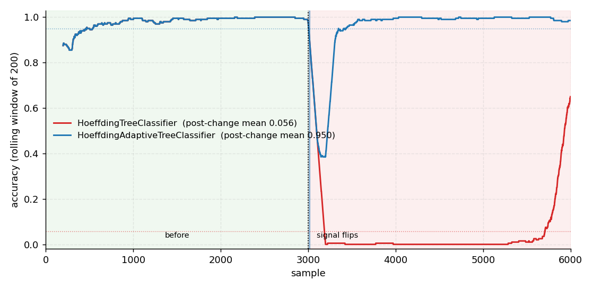

# Hoeffding Adaptive tree: it follows a change

When the world changes suddenly (a different load, a worn joint) a tree built on the old data
keeps giving the old answers. `HoeffdingAdaptiveTreeClassifier` puts a drift detector on every
internal node; when the error of a node jumps, it grows an alternative subtree in the
background and swaps it in once the new one is clearly better.

## 1. Following a sudden change

After 3000 samples the meaning of the torque flips (the load is now the low-torque state). The
same split on `tau` still separates the two states, but the answers are swapped. The adaptive
tree watches its own error with a drift detector (`ADWIN`) on each node; when the error jumps,
it grows a second subtree in the background and swaps it in when that subtree is clearly more
accurate.

```python
import numpy as np
from dense_armor.core.online.drift.adwin import ADWIN
from dense_armor.core.evaluation.metrics import Accuracy
from dense_armor.core.online.tree import HoeffdingAdaptiveTreeClassifier, HoeffdingTreeClassifier

rng = np.random.default_rng(1)
ht = HoeffdingTreeClassifier(grace_period=100)
hat = HoeffdingAdaptiveTreeClassifier(grace_period=100, drift_detector=ADWIN())
acc_ht, acc_hat = Accuracy(), Accuracy()
for i in range(6000):
    y = int(rng.random() < 0.5)
    c = 3.0 * y if i < 3000 else 3.0 * (1 - y)
    x = {"tau": rng.normal(2.0 + c, 0.5), "qd": rng.normal(0.0, 1.0)}
    if i >= 3000:
        acc_ht.update(y, ht.predict_one(x))
        acc_hat.update(y, hat.predict_one(x))
    ht.learn_one(x, y)
    hat.learn_one(x, y)
print(round(acc_ht.get(), 3), round(acc_hat.get(), 3), hat.n_drifts_, hat.n_swaps_)
```

```
0.056 0.95 3 1
```



Over the 3000 samples after the change, the plain tree is right 5.6 % of the time (it keeps the
old answers); the adaptive tree detected the change (3 drift signals), swapped in its background
subtree once, and is right 95 % of the time. The swap test compares the errors of the two
subtrees counted on the same samples since the background one started, and swaps when the
difference exceeds $\sqrt{\ln(2/\delta)/n}$ after at least `kappa_alt` samples.

## API reference

::: dense_armor.core.online.tree.adaptive

---

## Details

- Adaptive tree: a detector on each internal node (default `ADWIN`, cloned per node); swap and
  discard are decided only after `kappa_alt` (100) samples of the background subtree, on errors
  counted on the same samples. As in Esteban et al. (2024), the detectors sit on the internal
  nodes.
- The detector is any `DriftDetector` of the library (default `ADWIN`); see
  [drift detection](../drift/index.md).
- Sources: Esteban, A., Cano, A., Zafra, A., Ventura, S. (2024), "Hoeffding adaptive trees for
  multi-label classification on data streams", arXiv:2410.20242.
