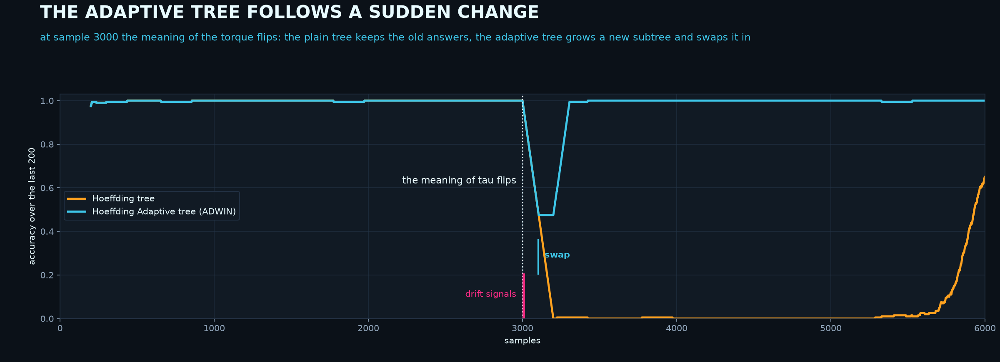

# Hoeffding Adaptive tree: it follows a change

When the world changes suddenly (a different load, a worn joint) a tree built on the old data
keeps giving the old answers. `HoeffdingAdaptiveTreeClassifier` puts a drift detector on every
internal node; when the error of a node jumps, it grows an alternative subtree in the
background and swaps it in once the new one is clearly better.

## Gamestory

New Year's Eve in London. A mysterious thief is emptying the banks of the city.

The young detective keeps a notebook with his theory: "the thief strikes the banks with the richest vaults". For the first half of the night it works. A stubborn detective (the plain Hoeffding tree) would keep the same theory until dawn: when the thief starts to strike only the poorest banks, he would be wrong every single time and would never notice.

Our detective reasons like a Hoeffding Adaptive tree. Next to every question of his theory there is a small alarm that counts how often that question is wrong. When an alarm rings, he does not throw the theory away: he opens a second notebook in the background, with the new clues, and goes on acting on the old one. He compares the two notebooks on the same cases, and as soon as the new one is clearly better he swaps them. Only the part of the theory that failed is replaced; everything else stays.

## 1. When the meaning of an amount changes

A fraud team watches card payments, half of them fraud. At first a fraud is a large payment (around 400) and a normal payment is small (around 60). After 3000 payments the fraudsters change habit: they now make small test charges, while the customers' payments grow. The meaning of the amount flips. Each payment is first predicted and then learned, and the accuracy is counted on the 3000 payments after the change.

```python
import numpy as np
from dense_armor.core.evaluation.metrics import Accuracy
from dense_armor.core.online.drift.adwin import ADWIN
from dense_armor.core.online.tree import HoeffdingAdaptiveTreeClassifier, HoeffdingTreeClassifier

rng = np.random.default_rng(0)
plain = HoeffdingTreeClassifier(grace_period=100)
adaptive = HoeffdingAdaptiveTreeClassifier(grace_period=100, drift_detector=ADWIN())
acc_plain, acc_adaptive = Accuracy(), Accuracy()
for i in range(6000):
    fraud = int(rng.random() < 0.5)
    big = fraud if i < 3000 else 1 - fraud
    x = {"amount": rng.normal(400 if big else 60, 60 if big else 20), "hour": rng.normal(14, 3)}
    if i >= 3000:
        acc_plain.update(fraud, plain.predict_one(x))
        acc_adaptive.update(fraud, adaptive.predict_one(x))
    plain.learn_one(x, fraud)
    adaptive.learn_one(x, fraud)
print(round(acc_plain.get(), 3), round(acc_adaptive.get(), 3), adaptive.n_drifts_, adaptive.n_swaps_)
```

```
0.044 0.964 3 1
```

After the change the plain tree is right 4.4 % of the time: it keeps the old rule, so it is wrong almost every time. The adaptive tree is right 96.4 % of the time: its alarm rang 3 times (`n_drifts_`) and it swapped in the new subtree once (`n_swaps_`). The next sections show the same behaviour on a robot arm, with the figure of what happens sample by sample.

## 2. A robot arm after a sudden change

After 3000 samples the meaning of the torque flips (the load is now the low-torque state). The
same split on `tau` still separates the two states, but the answers are swapped. The adaptive
tree watches its own error with a drift detector (`ADWIN`) on each node; when the error jumps,
it grows a second subtree in the background and swaps it in when that subtree is clearly more
accurate.

```python
import numpy as np
from dense_armor.core.online.drift.adwin import ADWIN
from dense_armor.core.evaluation.metrics import Accuracy
from dense_armor.core.online.tree import HoeffdingAdaptiveTreeClassifier, HoeffdingTreeClassifier

rng = np.random.default_rng(1)
ht = HoeffdingTreeClassifier(grace_period=100)
hat = HoeffdingAdaptiveTreeClassifier(grace_period=100, drift_detector=ADWIN())
acc_ht, acc_hat = Accuracy(), Accuracy()
for i in range(6000):
    y = int(rng.random() < 0.5)
    c = 3.0 * y if i < 3000 else 3.0 * (1 - y)
    x = {"tau": rng.normal(2.0 + c, 0.5), "qd": rng.normal(0.0, 1.0)}
    if i >= 3000:
        acc_ht.update(y, ht.predict_one(x))
        acc_hat.update(y, hat.predict_one(x))
    ht.learn_one(x, y)
    hat.learn_one(x, y)
print(round(acc_ht.get(), 3), round(acc_hat.get(), 3), hat.n_drifts_, hat.n_swaps_)
```

```
0.056 0.95 3 1
```



Over the 3000 samples after the change, the plain tree is right 5.6 % of the time (it keeps the
old answers); the adaptive tree detected the change (3 drift signals), swapped in its background
subtree once, and is right 95 % of the time. The swap test compares the errors of the two
subtrees counted on the same samples since the background one started, and swaps when the
difference exceeds $\sqrt{\ln(2/\delta)/n}$ after at least `kappa_alt` samples.

In the figure the pink ticks are the three drift signals (samples 3004, 3007 and 3010, a few
samples after the change) and the cyan tick is the swap, at sample 3103, once the background
subtree had been better for `kappa_alt` samples. The accuracy is the one over the last 200
predictions, so it falls over about 100 samples even for an instant change; the plain tree
reaches zero, because every answer is now the wrong one, and starts to recover only near the
end of the stream.

## API reference

::: dense_armor.core.online.tree.adaptive

---

## Details

- Adaptive tree: a detector on each internal node (default `ADWIN`, cloned per node); swap and
  discard are decided only after `kappa_alt` (100) samples of the background subtree, on errors
  counted on the same samples. As in Esteban et al. (2024), the detectors sit on the internal
  nodes.
- The detector is any `DriftDetector` of the library (default `ADWIN`); see
  [drift detection](../drift/index.md).
- Sources: Esteban, A., Cano, A., Zafra, A., Ventura, S. (2024), "Hoeffding adaptive trees for
  multi-label classification on data streams", arXiv:2410.20242.
