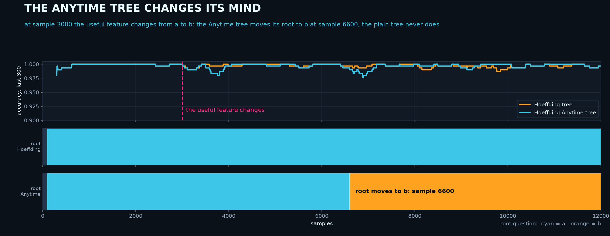

# Hoeffding Anytime tree: it can change a split

The Hoeffding tree never revisits a split. `HoeffdingAnytimeTreeClassifier` (the Extremely Fast
Decision Tree, Manapragada et al. 2018) splits a leaf as soon as a question is *good enough*,
and then keeps checking every internal node: when another question wins by the bound, it
replaces the old one. It gets an answer early and a better tree later, which is why it is
called anytime.

## Gamestory

New Year's Eve in London. A mysterious thief is emptying the banks of the city.

On his trail there is a young detective. At the beginning, to understand where the thief will strike, the detective fixates on a first main question: "Is the bank located near the river? Yes or no?"

A stubborn detective (the normal Hoeffding tree) would keep asking that same first question for the whole night, even if by now it is useless. Our detective instead reasons like a Hoeffding Anytime tree: he is fast at getting a first idea to act immediately, but every now and then he stops to recheck whether his main question is still the best one.

In the middle of the night, the thief stops choosing the banks near the river and starts striking only those without guards. The detective takes a little while to notice, because he wants to collect enough proof before changing his mind. But as soon as the new clues exceed the old ones, he does a brilliant thing: he replaces his first question with the new one ("Are there guards at night?"), making all his reasoning much cleaner and faster.

## 1. Changing a split that is no longer the best

At first variable `a` tells the state; after 3000 samples `a` stops mattering and `b` does. The
Hoeffding tree never revisits a split; the Hoeffding Anytime Tree re-checks every internal node
every `grace_period` samples and replaces its split when another one wins by the bound.

```python
import numpy as np
from dense_armor.core.online.tree import HoeffdingAnytimeTreeClassifier, HoeffdingTreeClassifier

rng = np.random.default_rng(2)
ht = HoeffdingTreeClassifier(grace_period=100)
ef = HoeffdingAnytimeTreeClassifier(grace_period=100)
for i in range(12000):
    y = int(rng.random() < 0.5)
    a = rng.normal(3.0 * y if i < 3000 else 0.0, 0.5)
    b = rng.normal(3.0 * y if i >= 3000 else 0.0, 0.5)
    ht.learn_one({"a": a, "b": b}, y)
    ef.learn_one({"a": a, "b": b}, y)
print(ht.root_.split_feature_, ef.root_.split_feature_, ef.n_replaced_)
```

```
a b 2
```

The Hoeffding tree keeps its first question on `a` forever; the Anytime tree moved its root to
`b` (2 splits replaced in total). It changes its mind only once the statistics of all the
samples it has seen favour the new split, so it is slow after a sudden change: the next step is
faster.



The figure follows the same stream for 12000 samples. The two bars are the question at the root
of each tree: the plain tree asks about `a` for ever; the Anytime tree asks about `a` until
sample 6600, 3600 samples after the change, and about `b` after it. The accuracy (top) stays
near 1.0 for both here, because the leaves below the root keep learning; what changes is the
question the tree asks first, which is what `explain_one` shows to a person.

## API reference

::: dense_armor.core.online.tree.efdt

---

## Details

- Anytime tree: every `grace_period` samples each internal node re-evaluates its candidate
  splits on the statistics of all the samples that went through it; the replacement follows
  Manapragada et al. (2018), Algorithm 3.1 and Functions 3.2 and 3.3. The options of the
  Hoeffding tree (`criterion`, `splitter`, `nominal_attributes`, `max_active_leaves`) are
  inherited, see the [Hoeffding tree](hoeffding.md).
- Sources: Manapragada, C., Webb, G. I., Salehi, M. (2018), "Extremely fast decision tree",
  arXiv:1802.08780.
