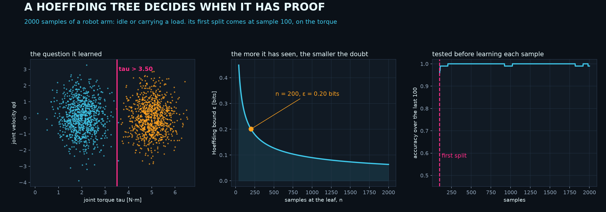
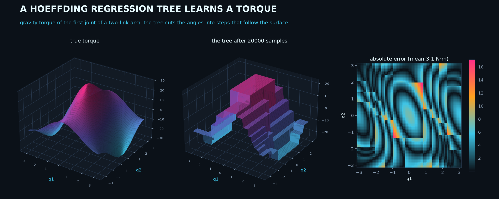

# Hoeffding tree: a tree that waits for proof

A decision tree asks a chain of yes/no questions and ends with an answer. The Hoeffding tree
(Domingos and Hulten 2000) learns that chain **one sample at a time**: a leaf becomes a question
only when the data it has seen prove, with a stated probability, that the question is the best
one. It never needs the whole table in memory, and it can be read: `explain_one` gives the path
of questions behind each answer.

| class | predicts | page section |
|---|---|---|
| `HoeffdingTreeClassifier` | a class, with its probabilities | 1 and 2 |
| `HoeffdingTreeRegressor` | a number | 3 |

Trees that change their mind after a split are on the next pages: the
[Anytime tree](efdt.md) and the [Adaptive tree](adaptive.md).

## 1. A tree that flags card payments

A bank wants to flag card payments that look like fraud. Three thousand payments arrive one at a time: most are small and made in the afternoon (an amount around 60, at about 14:00), a few are large and made at night (an amount around 400, at about 03:00). After each payment the tree is told whether it was fraud.

```python
import numpy as np
from dense_armor.core.online.tree import HoeffdingTreeClassifier

rng = np.random.default_rng(0)
tree = HoeffdingTreeClassifier(grace_period=100)
for _ in range(3000):
    normal = rng.random() < 0.8
    amount = rng.normal(60, 20) if normal else rng.normal(400, 100)
    hour = rng.normal(14, 3) if normal else rng.normal(3, 2)
    tree.learn_one({"amount": amount, "hour": hour}, int(not normal))
print(tree.predict_one({"amount": 45.0, "hour": 15.0}), tree.predict_one({"amount": 420.0, "hour": 2.0}))
print(tree.explain_one({"amount": 420.0, "hour": 2.0}))
print(tree.n_nodes_, tree.predict_proba_one({"amount": 420.0, "hour": 2.0}))
```

```
0 1
[{'feature': 'amount', 'threshold': 232.60942718228952, 'side': 'right'}]
3 {0: 0.0, 1: 1.0}
```

The tree has 3 nodes: one question, *is the amount above 232.61?*, and two leaves. The threshold lies between the usual amounts and the suspicious ones, and the hour was not needed. `predict_proba_one` gives the probability of each class (here the tree is sure), and `explain_one` the path of questions behind an answer. When to split, and why the tree can be trusted to do so, is in the next section.

## 2. For experts: a tree that learns a robot state

Two states of an arm: idle (0) and carrying a load (1). The load raises the joint torque
`tau`; the velocity `qd` says nothing about it.

```python
import numpy as np
from dense_armor.core.online.tree import HoeffdingTreeClassifier

rng = np.random.default_rng(0)
ht = HoeffdingTreeClassifier(grace_period=100)
for _ in range(2000):
    y = int(rng.random() < 0.5)
    x = {"tau": rng.normal(2.0 + 3.0 * y, 0.5), "qd": rng.normal(0.0, 1.0)}
    ht.learn_one(x, y)
print(ht.predict_one({"tau": 1.8, "qd": 0.3}), ht.predict_one({"tau": 5.2, "qd": -0.4}))
print(ht.explain_one({"tau": 5.2, "qd": -0.4}))
```

```
0 1
[{'feature': 'tau', 'threshold': 3.5024219539142933, 'side': 'right'}]
```

The tree split on `tau` at 3.50, halfway between the two states (2.0 and 5.0), and ignored
`qd`. `explain_one` gives the path of questions for one sample. When to split: every
`grace_period` samples a leaf compares the two best splits; it splits when the gain of the best
exceeds the second by more than the Hoeffding bound (Manapragada et al. 2018, eq. 1):

$$\epsilon = \sqrt{\frac{R^2 \ln(1/\delta)}{2n}}$$

$R$ is the range of the gain ($\log_2$ of the number of classes), $n$ the samples at the leaf,
$\delta$ the probability of choosing the wrong split. With two classes ($R = 1$),
$\delta = 10^{-7}$ and $n = 200$, $\epsilon = 0.20$: the best split must win by 0.20 bits.



Left: the 2000 samples of the first example, the two states of the arm and the one question the
tree learned. Centre: the doubt it must overcome before asking it, the bound $\epsilon$, which
falls as the leaf sees more samples. Right: the accuracy of the last 100 predictions, tested
before the tree learns each sample; the first split comes at sample 100, the first moment the
tree is allowed to check (`grace_period=100`).

## 3. For experts: predicting a number, `HoeffdingTreeRegressor`

The same idea for a number: a split is made when it lowers the variance of the target enough,
by the same bound. It predicts the gravity torque of the first joint of a two-link arm from the
two joint angles, tested before learning each sample.

```python
import numpy as np
from dense_armor.core.evaluation.metrics import MeanAbsoluteError
from dense_armor.core.online.tree import HoeffdingTreeRegressor

rng = np.random.default_rng(3)
ht = HoeffdingTreeRegressor(grace_period=100)
mae, mae_mean, mean, n = MeanAbsoluteError(), MeanAbsoluteError(), 0.0, 0
for _ in range(20000):
    q1, q2 = rng.uniform(-np.pi, np.pi, 2)
    tau = 9.81 * (2.0 * np.cos(q1) + np.cos(q1 + q2))
    x = {"q1": q1, "q2": q2}
    mae.update(tau, ht.predict_one(x))
    mae_mean.update(tau, mean)
    ht.learn_one(x, tau)
    n += 1
    mean += (tau - mean) / n
print(round(mae.get(), 3), round(mae_mean.get(), 3), ht.n_nodes_, ht.n_active_leaves_)
```

```
5.159 13.241 73 37
```

The mean absolute error is 5.2 N·m against 13.2 N·m for the running mean, with 73 nodes, 37 of
them leaves that still keep statistics. The stochastic gradient tree on the [same
problem](sgt.md) reaches 7.7 N·m with 91 nodes.



The figure shows what the tree learned: the torque (left) cut into flat steps (centre), more
and finer where the surface bends. The error map (right) is measured on a regular grid of
angles after the 20000 samples (mean 3.1 N·m); the 5.2 N·m above is the error of each
prediction tested before learning, so it includes the early samples, when the tree was small.

## API reference

::: dense_armor.core.online.tree.hoeffding
::: dense_armor.core.online.tree.hoeffding_regressor
::: dense_armor.core.online.tree.splitters

---

## Details

- Hoeffding tree: each leaf keeps a Gaussian per class and feature; candidate thresholds are
  midpoints between consecutive class means; leaves predict with naive Bayes (`leaf="nb"`) or
  the majority class; `tau` (0.05) is the tie threshold. Domingos and Hulten (2000) introduced
  the tree; the bound and the Anytime variant are from Manapragada et al. (2018), Algorithm 3.1,
  Functions 3.2 and 3.3.
- Hoeffding tree options: `criterion` is `"entropy"` (default) or `"gini"`; `splitter` is
  `"class_means"` (default, the midpoints above), `"gaussian"` (`n_splits` evenly spaced
  thresholds, the Gaussian CDF of each class on both sides), `"ebst"` (every distinct value is
  kept and every boundary is evaluated exactly, Ikonomovska et al. 2011) or `"quantile"` (values
  quantized into slots of width `quantile_radius`, a third of the standard deviation of the first
  30 values by default, Mastelini and de Carvalho 2021). Features named in `nominal_attributes`
  (or all non-numeric strings with `"auto"`) are categorical: the split is "equals this
  category" against the rest and the naive Bayes leaf uses Laplace-smoothed frequencies.
- The tree has no node or depth limit by default: it grows to whatever depth the data justify.
  To keep the memory bounded the leaves with the least promise are deactivated: every
  `memory_period` (1000) samples only the `max_active_leaves` (1000) leaves that made the most
  errors keep their statistics, the others keep counting the classes and predict the majority
  but no longer split (Domingos and Hulten 2000, section 3.2). `max_depth` and `max_nodes`
  remain available. `HoeffdingTreeRegressor` splits on the variance reduction with the same
  observers (`"ebst"` default, `"quantile"`), and the same options for categories and memory.
- The classes of this page bound their size with `max_active_leaves`; `budget_s` is about ten times
  the 99th percentile of `learn_one` measured on a desktop CPU.
- Sources: Domingos, P., Hulten, G. (2000), "Mining high-speed data streams", KDD. Manapragada,
  C., Webb, G. I., Salehi, M. (2018), "Extremely fast decision tree", arXiv:1802.08780.
  Ikonomovska, E., Gama, J., Dzeroski, S. (2011), "Learning model trees from evolving data
  streams". Mastelini, S. M., de Carvalho, A. C. P. L. F. (2021), "Using dynamical quantization
  to perform split attempts in online tree regressors".
