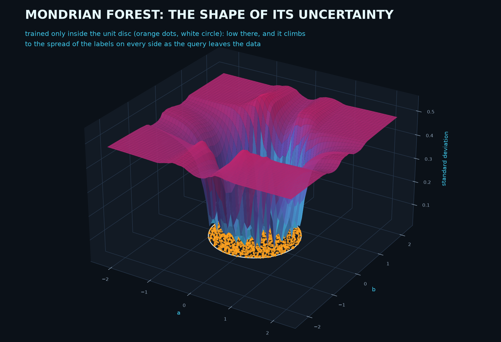
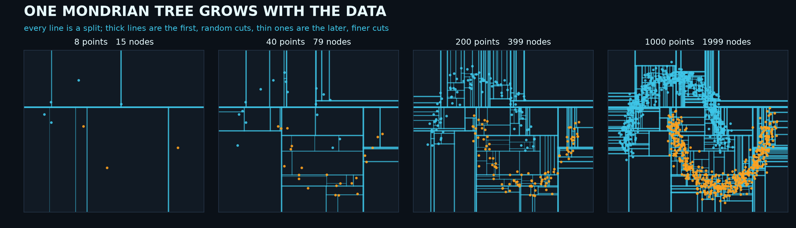
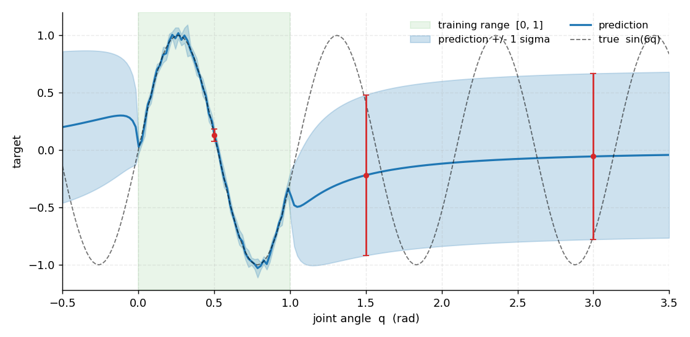
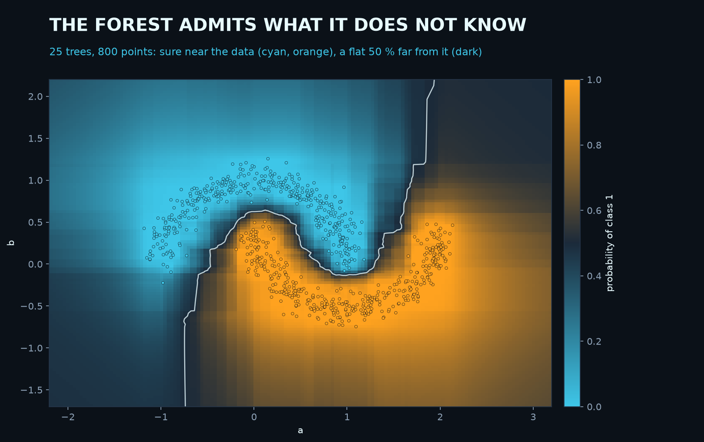

# Mondrian forests: a prediction that knows when it does not know

Most models answer every question with the same confidence, even about a place they have never
seen. A Mondrian forest answers with a number **and** with how sure it is: close to the data it
has seen the doubt is small, and it grows on every side as the question moves away. A robot
controller can use that doubt to slow down, to ask for help or to refuse to act.



The forest above was trained only on points inside the white circle. Over the circle the
standard deviation is low (0.14 on average); outside, at a distance of more than 1.6 from the
centre, it is 0.48 on average, which is about the spread of the labels themselves: the forest
has nothing to say, and it says so.

| class | predicts | what it adds |
|---|---|---|
| `MondrianForestRegressor` | a number | a mean and a standard deviation (`return_estimate=True`) |
| `MondrianForestClassifier` | a class | the probability of each class, flat when it does not know |

## The idea, as a game

A long time ago there was a painter called Piet Mondrian. At the beginning he painted normal
trees and landscapes, but then he had a crazy idea: he decided to eliminate everything and to
use only straight black lines to divide the white canvas into many squares and rectangles,
coloring them only in red, yellow and blue. His paintings looked like super tidy colored maps.

Now imagine turning his paintings into a game to play with 10 friends. Each of you has a blank
sheet of paper. Every time someone puts a colored dot on the sheet, you draw a straight line to
enclose that dot inside its own rectangle. At the end you will have 10 Mondrian-style
paintings, all different from each other.

Then someone closes their eyes, points a finger at a spot on the sheet and asks: "What color is
here?"

- If all 10 of you look at your drawing and say "Red!", then you are super sure.
- If instead one says "Red", one "Blue" and another "Yellow", you immediately understand that at
  that spot you have no idea, and you say: "We don't know!"

That is a Mondrian forest: a team of 10 "painters" that divides space into colored rectangles
to guess things, and is smart enough to admit when it does not know the answer yet. In the
library the painters are the trees (`n_trees=10` by default), the dots are the samples, the
colors are the labels (or, for a number, the values) and the lines are drawn at random.

## 1. Random trees that grow with the data

A Mondrian tree cuts the space of the features into boxes, like the paintings it is named
after. The cuts are **random**: the feature is chosen with a probability proportional to the
size of the box along it, and the position is uniform. Nothing is optimised, so a new sample
costs a walk down one path and a few cuts, never a search for the best question.

```python
import numpy as np
from dense_armor.core.online.tree import MondrianForestRegressor

rng = np.random.default_rng(0)
mf = MondrianForestRegressor(n_trees=1, seed=0)
for i in range(1, 1001):
    q = rng.uniform(0.0, 1.0)
    mf.learn_one({"q": q}, np.sin(6.0 * q))
    if i in (10, 100, 1000):
        print(i, mf.trees_[0].n_nodes)
```

```
10 19
100 199
1000 1999
```

With the default (infinite) lifetime every sample ends in a box of its own, so a tree of `n`
samples has `2n - 1` nodes. The picture shows one tree on two interleaved half-moons as the
samples arrive: the first cuts are long and cross the whole square, the later ones are short
and gather where the data are.



## 2. A number and its doubt

A forest of 10 random trees, trained on joint positions between 0 and 1 only, is asked inside
and outside that range.

```python
import numpy as np
from dense_armor.core.online.tree import MondrianForestRegressor

rng = np.random.default_rng(4)
mf = MondrianForestRegressor(n_trees=10, seed=0)
for _ in range(1000):
    q = rng.uniform(0.0, 1.0)
    mf.learn_one({"q": q}, np.sin(6.0 * q) + rng.normal(0.0, 0.05))
for q in (0.5, 1.5, 3.0):
    e = mf.predict_one({"q": q}, return_estimate=True)
    print(q, round(e.mean, 3), round(e.std, 3))
```

```
0.5 0.131 0.054
1.5 -0.219 0.7
3.0 -0.055 0.723
```



At `q = 0.5` (inside the data) the prediction 0.131 is close to the true `sin(3) = 0.141`, with
a standard deviation of 0.054, about the noise of the data. Outside the data the standard
deviation jumps to 0.70: the forest says "I do not know".

## 3. Use the doubt: act or ask

The standard deviation is a number, so it can drive a decision. A controller that acts only
when the forest is sure, and asks otherwise:

```python
import numpy as np
from dense_armor.core.online.tree import MondrianForestRegressor

rng = np.random.default_rng(4)
mf = MondrianForestRegressor(n_trees=10, seed=0)
for _ in range(1000):
    q = rng.uniform(0.0, 1.0)
    mf.learn_one({"q": q}, np.sin(6.0 * q) + rng.normal(0.0, 0.05))
for q in (0.2, 0.9, 1.2, 2.0):
    e = mf.predict_one({"q": q}, return_estimate=True)
    print(q, round(e.mean, 3), round(e.std, 3), "ask" if e.std > 0.3 else "go")
```

```
0.2 0.904 0.051 go
0.9 -0.755 0.069 go
1.2 -0.377 0.623 ask
2.0 -0.118 0.72 ask
```

The two queries inside the range (0.2 and 0.9) get a standard deviation near the noise and the
controller goes; the two outside (1.2 and 2.0) are above 0.6 and it asks. The threshold 0.3 is
a choice for this signal: set it from the doubt you see on data you know.

## 4. Classes, and what the forest does away from them

`MondrianForestClassifier` returns the probability of each class. Two classes, with `a` centred
at 0 and at 3, and `b` pure noise:

```python
import numpy as np
from dense_armor.core.online.tree import MondrianForestClassifier

rng = np.random.default_rng(1)
mc = MondrianForestClassifier(n_trees=10, seed=0)
for _ in range(1500):
    y = int(rng.random() < 0.5)
    mc.learn_one({"a": rng.normal(3.0 * y, 0.5), "b": rng.normal(0.0, 0.5)}, y)
for a in (0.0, 1.5, 3.0, 9.0):
    p = mc.predict_proba_one({"a": a, "b": 0.0})
    print(a, {k: round(v, 3) for k, v in sorted(p.items())})
```

```
0.0 {0: 1.0}
1.5 {0: 0.317, 1: 0.683}
3.0 {1: 1.0}
9.0 {0: 0.387, 1: 0.613}
```

Inside each class the forest is certain (1.0). Between the two classes, at `a = 1.5`, it splits
its vote. Far away, at `a = 9`, it does **not** become sure: the probabilities fall back towards
an even split (0.39 and 0.61) instead of staying at 1.0, because the probability of branching
off before each node grows with the distance. The map shows it on two half-moons: the colours
are bright over the data and fade to a flat 50 % far from it.



## 5. The parameters

| parameter | meaning | default |
|---|---|---|
| `n_trees` | trees in the forest; more trees give a steadier mean and doubt, at a linear cost | 10 |
| `lifetime` | how far the Mondrian process runs; a short lifetime stops the cuts early and gives coarse boxes | infinite |
| `max_nodes` | cap on the nodes of each tree | 10000 |
| `seed` | base seed; tree `i` uses `seed + i` | 0 |

The effect of `lifetime` on one tree trained on 1000 samples of the stream above:

| lifetime | 0.5 | 2 | 10 | infinite |
|---|---|---|---|---|
| nodes | 1 | 3 | 17 | 1999 |

A tree with lifetime 0.5 is a single box (one mean for everything); at infinity every sample
has its own box.

## 6. Where the doubt comes from

Walking down a tree, a point outside the box of a node "branches off" before that node with
probability (Lakshminarayanan et al. 2016, Algorithm 5)

$$p_j(x) = 1 - e^{-\Delta_j \eta_j(x)}, \qquad \Delta_j = \tau_j - \tau_{\mathrm{parent}(j)}$$

$\eta_j(x)$ is how far $x$ lies outside the box and $\tau$ the split times of the Mondrian
process. The prediction is the mixture of the statistics of the nodes on the path, weighted by
these probabilities (eq. 3), so the farther the point, the more weight goes to the large boxes
near the root, and the wider the mixture. For the forest the variance adds the spread between
the trees to the mean variance inside them.

## API reference

::: dense_armor.core.online.tree.mondrian

---

## Details

- Split times follow Algorithm 2 (leaves have time equal to the lifetime) and new points extend
  the tree with Algorithm 4 of the 2014 paper, so online and batch trees have the same
  distribution (eq. 1 there); every node keeps the statistics of its block.
- With the default lifetime (infinite) a tree keeps growing until `max_nodes`.
- Departure from the paper: classification uses normalised class histograms in the mixture
  instead of the hierarchical smoothing of the paper, and blocks are not paused when their
  labels are all identical.
- `max_nodes` (default 10000) bounds each tree; `budget_s` is about ten times the 99th
  percentile of `learn_one` measured on a desktop CPU.
- The aggregated version of the forest, with the weights of the trees learned online, is on the
  [Forests](../forest/index.md) page (`AggregatedMondrianForestClassifier` and
  `AggregatedMondrianForestRegressor`).
- Figures on this page are generated by `docs/assets/tree/make_mondrian.py` and
  `docs/assets/tree/make_figure.py`.
- Sources: Lakshminarayanan, B., Roy, D. M., Teh, Y. W. (2014), "Mondrian forests: efficient
  online random forests", arXiv:1406.2673; (2016) "Mondrian forests for large-scale regression
  when uncertainty matters", arXiv:1506.03805. Roy, D. M., Teh, Y. W. (2009), "The Mondrian
  process", NIPS.
