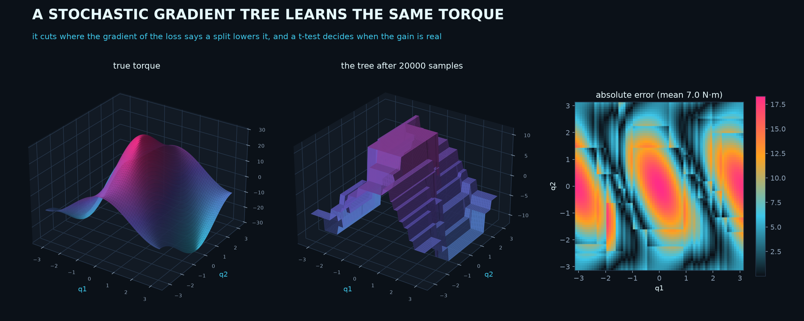

# Stochastic gradient trees: a tree that follows the loss

A Hoeffding tree needs a statistic that depends on the task (entropy for classes, variance for
numbers). A stochastic gradient tree (Gouk et al. 2019) uses one rule for both: it splits where
the **gradient of the loss** says a split would lower it, and a t-test decides whether the gain
is real. `SGTRegressor` predicts a number and `SGTClassifier` a binary class, with the same
code underneath and a small, fixed set of bins per feature.

## Gamestory

New Year's Eve in London. A mysterious thief is emptying the banks of the city.

On his trail there is a young detective, but this time he has a double problem: he must not only guess if the thief will strike a bank (yes or no), but also how much money he will manage to steal.

Traditional detectives use two completely different methods: one to make "yes/no" predictions and another to calculate numbers. Our detective instead reasons like a Stochastic Gradient Tree: he uses a single universal rule to do both things.

To avoid mistakes, he keeps a small notebook where he writes down every mistake of his: by how much he missed the prediction and in which direction he must adjust his aim to get closer to the truth.

He never adds a new question to his scheme at random or by simple intuition. He always checks the notebook and adds a new question only when the math proves to him with certainty that that question truly reduces his mistakes, and that it was not just a stroke of luck. By doing so, whether he has to guess a loot in millions or answer yes or no, he always and only follows what cuts away the mistake.

## 1. Flagging card payments

The same card payments as in the first example of the [Hoeffding tree](hoeffding.md): 80 % normal, a few large ones at night that are fraud. `SGTClassifier` is binary: the label is 1 for fraud. Each payment is first predicted and then learned, and the accuracy is counted from payment 500 on.

```python
import numpy as np
from dense_armor.core.evaluation.metrics import Accuracy
from dense_armor.core.online.tree import SGTClassifier

rng = np.random.default_rng(0)
sgt = SGTClassifier()
acc = Accuracy()
for i in range(3000):
    normal = rng.random() < 0.8
    amount = rng.normal(60, 20) if normal else rng.normal(400, 100)
    hour = rng.normal(14, 3) if normal else rng.normal(3, 2)
    x = {"amount": amount, "hour": hour}
    y = int(not normal)
    if i >= 500:
        acc.update(y, sgt.predict_one(x))
    sgt.learn_one(x, y)
print(round(acc.get(), 3), sgt.n_nodes_)
for x in ({"amount": 45.0, "hour": 15.0}, {"amount": 420.0, "hour": 2.0}):
    print(sgt.predict_one(x), round(sgt.predict_proba_one(x)[1], 3))
```

```
0.947 3
0 0.218
1 0.776
```

The tree is right 94.7 % of the time, with 3 nodes (one question and two leaves). The probabilities are less extreme than those of the Hoeffding tree on the same data (0.22 and 0.78, where the Hoeffding tree said 0 and 1): the penalty on the leaf values (`lambda_`) keeps them away from 0 and 1. The next sections use `SGTRegressor` on a robot arm.

## 2. Predicting a number: the torque of a two-link arm

A regression tree that splits on the gradient of the loss (stochastic gradient tree): it
predicts the gravity torque of the first joint of a two-link arm from the two joint angles.

```python
import numpy as np
from dense_armor.core.evaluation.metrics import MeanAbsoluteError
from dense_armor.core.online.tree import SGTRegressor

rng = np.random.default_rng(3)
sgt = SGTRegressor()
mae_sgt, mae_mean, mean, n = MeanAbsoluteError(), MeanAbsoluteError(), 0.0, 0
for _ in range(20000):
    q1, q2 = rng.uniform(-np.pi, np.pi, 2)
    tau = 9.81 * (2.0 * np.cos(q1) + np.cos(q1 + q2))
    x = {"q1": q1, "q2": q2}
    mae_sgt.update(tau, sgt.predict_one(x))
    mae_mean.update(tau, mean)
    sgt.learn_one(x, tau)
    n += 1
    mean += (tau - mean) / n
print(round(mae_sgt.get(), 3), round(mae_mean.get(), 3), sgt.n_nodes_)
```

```
7.715 13.241 91
```



Tested before learning each sample, the tree's mean absolute error is 7.7 N·m against
13.2 N·m for the running mean, with 91 nodes. The error map in the figure is measured on a
regular grid of angles after the 20000 samples (mean 7.0 N·m), and shows where the tree is
still coarse: the two ridges of the torque, which it has cut into only a few steps. A split is made only when a t-test says the loss
reduction is real (Gouk et al. 2019, eq. 16):

$$t = \frac{\bar L}{s / \sqrt{n}}$$

$\bar L$ is the mean change of the loss over the $n$ samples of the leaf, $s$ its standard
deviation; the split happens when the one-sided p-value is below `delta` (0.01). The variance of
each sample's change uses the gradient $G$, the Hessian $H$ and the value $v$ of the new leaf
(eq. 18):

$$\operatorname{Var}(L_i) = v^2 \operatorname{Var}(G) + \tfrac14 v^4 \operatorname{Var}(H) + v^3 \operatorname{Cov}(G, H)$$

## API reference

::: dense_armor.core.online.tree.sgt

---

## Details

- Stochastic gradient trees: features are cut into 64 equal-width bins, their range estimated on
  the first 1000 samples (section 3.2); per-bin moments of gradient and Hessian are merged with
  the pairwise update before eq. 18; the t distribution is computed with the regularized
  incomplete beta function, no external library at runtime; `SGTClassifier` is binary.
- Sources: Gouk, H., Pfahringer, B., Frank, E. (2019), "Stochastic gradient trees",
  arXiv:1901.07777.
