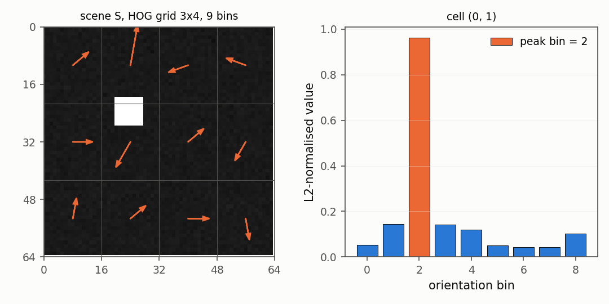
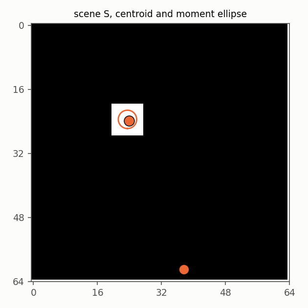
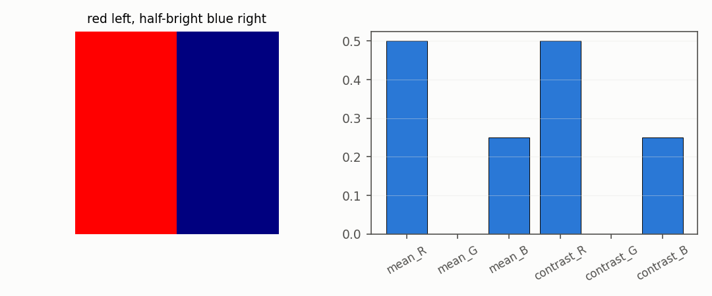

# Features: what a frame carries

## 2. Edges and their direction

The gradient of an image says how fast the brightness changes and in which
direction. The image is cut into cells, and each cell counts how much edge
it has in each direction, one histogram per cell. This is the idea behind
the histogram of oriented gradients.

```python
import numpy as np
from dense_armor.utility.vision import FrameFeatures

img = np.zeros((16, 16), dtype=np.float32)
img[8:, :] = 1.0
ff = FrameFeatures(n_bins=4, cells=(1, 1))
out = ff.transform_one(img)
print([round(out[f"hog_0_0_{j}"], 3) for j in range(4)])
```

```
[0.0, 1.0, 0.0, 0.0]
```

The image is dark on top and bright at the bottom, so the edge between the
two halves is horizontal. All the gradient mass lands in one direction bin;
the other three bins are zero. The library saw an edge of a certain
direction, and nothing else.

The gradient at each pixel is a central difference of the neighbouring
brightness values,

$$I_x = \tfrac12\,(I_{y,x+1} - I_{y,x-1}), \quad I_y = \tfrac12\,(I_{y+1,x} - I_{y-1,x}), \quad
m = \sqrt{I_x^2 + I_y^2}, \quad \theta = \operatorname{atan2}(I_y, I_x)$$

Every pixel carries a magnitude `m` (how strong the edge is) and an angle
`θ` (which way it points). Inside a cell, the pixel votes into the bin of
its angle, with a weight equal to `m`. The cell histogram is then divided
by its own length, so a brighter scene gives the same numbers as a dimmer
one with the same shapes. The construction and the choice of nine bins per
cell are the ones described in Huang and Huang (2017).

Why does this work? Because edges are robust in a way that brightness is
not. A person walking past a camera changes the brightness of a thousand
pixels slightly, because the light in the room shifted, but the direction
of every edge on the person stays the same. The oriented histogram sees
the edges and ignores the brightness. A descriptor that survives a change
in the room lights is what a robot wants.



## 3. Where the light is

Three global numbers summarise the intensity of the frame: the mean, the
contrast, and the centre of mass of the brightness.

```python
import numpy as np
from dense_armor.utility.vision import FrameFeatures

img = np.zeros((20, 20), dtype=np.float32)
img[2:6, 14:18] = 1.0
out = FrameFeatures().transform_one(img)
print(round(out["mean"], 3), round(out["centroid_x"], 3), round(out["centroid_y"], 3))
```

```
0.04 0.816 0.184
```

A small bright square near the top right. The mean is low because most of
the frame is black. The centroid sits at `x = 0.816` (towards the right)
and `y = 0.184` (towards the top), where the light is. A zero on either
axis means the left or the top edge, a one means the right or the bottom.

Three numbers, and between them they tell a surprisingly large part of
the story. A bright object entering from the left moves the centroid to
the left; a shadow passing over the scene lowers the mean; a person walking
close to the camera raises the contrast. None of these three numbers is
interesting on its own, but together they catch a whole family of changes
that the edges alone would miss — a light switched off, a lens partially
covered, a foggy window. All three are computed with a single pass over
the frame and no stored state.



## 4c. Colour

By default everything on this page is computed on the grey version of the
frame: the luminance, `0.299 R + 0.587 G + 0.114 B`, the standard luminance weights. Grey is enough for edges and for flow,
because a moving shape carries its edges with it whether it is red, green
or blue. But a robot that needs to distinguish a red light from a green
one, or to notice that a lamp has changed colour, benefits from knowing the
three channels separately. Turning `gray=False` adds six numbers and leaves
the rest of the descriptor untouched.

```python
import numpy as np
from dense_armor.utility.vision import FrameFeatures

img = np.zeros((20, 20, 3), dtype=np.float32)
img[:, :10, 0] = 1.0
img[:, 10:, 2] = 0.5
out = FrameFeatures(gray=False).transform_one(img)
print({k: round(out[k], 3) for k in ("mean_R", "mean_G", "mean_B", "contrast_R", "mean")})
```

```
{'mean_R': 0.5, 'mean_G': 0.0, 'mean_B': 0.25, 'contrast_R': 0.5, 'mean': 0.178}
```

The left half of the image is red, the right half is half-bright blue. The
red channel is 1.0 on the left and 0.0 on the right, so its mean is 0.5;
the contrast, the standard deviation, is also 0.5 because the values are
split in two equal halves. Green is zero everywhere, so its mean and
contrast are both 0. Blue is 0.5 on the right half and 0.0 elsewhere,
giving a mean of 0.25. The last number is the grey mean, which is the
luminance averaged over the whole image: 0.299 times 0.5 for the red half,
plus 0.114 times 0.25 for the blue half, plus zero for the green, equals
0.178.

The six colour keys are `mean_R`, `mean_G`, `mean_B`, `contrast_R`,
`contrast_G`, `contrast_B`. The edges (HOG) and the flow still run on the
grey image, so a change in the room lights does not ripple through every
other number. A robot that does not care about colour never pays for the
three extra channels.



### API

- [`FrameFeatures`](../api/general.md#framefeatures)
