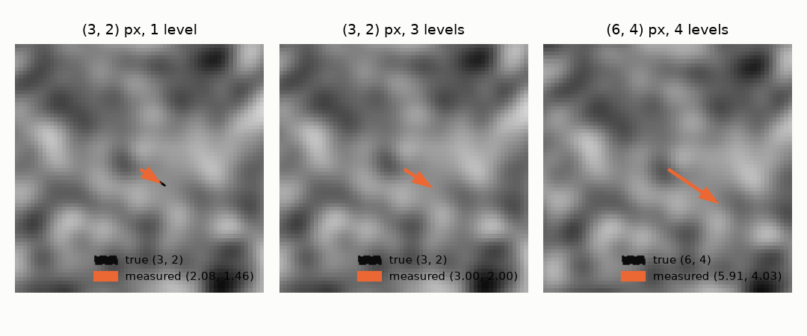
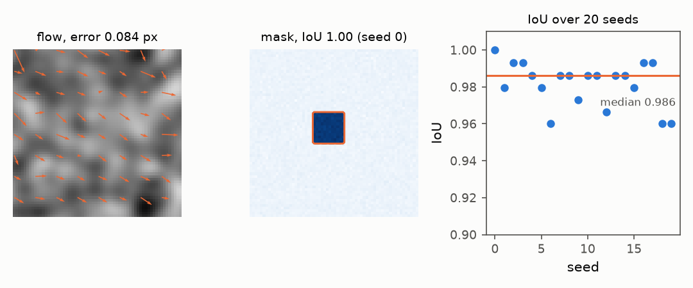

# Motion: how far things moved between two frames

## 4. What moved: optical flow

Comparing a frame with the previous one says how far things moved in the
time between the two frames. The library solves a small least-squares
problem in every cell of a coarse grid; this is the Lucas–Kanade method.

```python
import numpy as np
from dense_armor.utility.vision import FrameFeatures

a = np.zeros((16, 16), dtype=np.float32)
a[6:10, 6:10] = 1.0
b = np.roll(a, 1, axis=1)
ff = FrameFeatures(flow_cells=(2, 2))
ff.learn_one(a)
out = ff.transform_one(b)
print(round(float(np.mean([out[f"flow_u_{i}_{j}"] for i in range(2) for j in range(2)])), 3))
```

```
1.0
```

The square moved one pixel to the right. The mean horizontal flow, averaged
over the four cells of the flow grid, is exactly 1: the library saw one
pixel of motion to the right, and nothing vertically.

Inside one cell, every pixel provides one equation `I_x u + I_y v = -I_t`,
where `I_x` and `I_y` are the spatial gradients and `I_t` is the difference
between the current and the previous frame. A single equation has two
unknowns (the aperture problem). Stacking all the equations of the cell gives an over-determined
system,

$$A\,w = b, \qquad w = (A^\top A)^{-1} A^\top b, \qquad w = (u, v)$$

with `A` the matrix of the stacked gradients, `b` the vector of the negative
temporal differences, and `w` the flow vector. This is equations (4) and
(5) of that paper. When the cell has little texture, `A^T A` is close to
singular; the library uses a least-squares solver that returns the
minimum-norm solution, which is zero flow when the cell has no texture at
all.

The aperture problem is the reason a single pixel is not enough. Staring
at one pixel through a small hole, you cannot tell whether the pattern
moved left or up and to the side; the equation constrains only the
component of motion perpendicular to the edge. Lucas and Kanade solved
this in 1981 by looking at a whole neighbourhood at once, and that is what
the code above does: every cell stacks its equations and solves them
together. The global alternative from the same year, Horn and Schunck,
adds a smoothness term over the whole image and solves one large system;
Dense-Armor stays local because a robot needs the answer in a few
milliseconds, and a small least-squares per cell delivers that.

## 4b. Bigger motions: the pyramid

Lucas–Kanade assumes that what moved between two frames moved by a small
amount, one or two pixels at most. The assumption is buried in the
first-order Taylor expansion of the brightness constancy equation, and it
is not optional: when the motion is bigger, the linearisation is wrong and
the least-squares lands on the wrong answer. On a robot moving at 30
frames per second this rarely matters for slow motions, but a fast arm
sweeping across the field of view, or a hand waving close to the camera,
produce jumps of ten or twenty pixels per frame. For those, the library
builds a small pyramid of images and works from the top down.

```python
import numpy as np
from dense_armor.utility.vision import FrameFeatures

a = np.zeros((64, 64), dtype=np.float32)
a[24:40, 20:36] = 1.0
b = np.roll(a, 6, axis=1)
for levels in (1, 3):
    ff = FrameFeatures(flow_cells=(1, 1), flow_levels=levels)
    ff.learn_one(a)
    print(levels, round(ff.transform_one(b)["flow_u_0_0"], 2))
```

```
1 1.0
3 6.0
```

The square jumped 6 pixels to the right. With a single level the library
sees a flow of 1.0, six times too small: the equation was linearised at
the original position and the gradient of the square's edge only supports
a small correction. With three levels the answer is 6.0, exactly right.
The pyramid did not make the code smarter; it made the motion look smaller
at first.

The scheme has three steps, all of them classical:

- **Build the pyramid.** Each level is the level below, averaged over 2×2
  blocks, so the image at level `l+1` has half the height and half the
  width of level `l`. The square's jump of 6 pixels at the finest level is
  a jump of 3 at the second level and a jump of 1.5 at the third; at the
  coarsest, Lucas–Kanade is back inside its comfort zone.
- **Solve at the coarsest level.** The least-squares of section 4 is run
  on the smallest image, with zero initial flow. It gives an approximate
  motion, small in the coarse pixels but already pointing the right way.
- **Go down one level and refine.** The flow is doubled (the pixels are
  twice as big at the level above, so a motion in those pixels is a motion
  twice as large in the pixels below), the previous image is shifted by it
  and compared to the current one, and Lucas–Kanade solves for what is
  left. The refinement is added to the coarse flow, and the process
  repeats until the finest level.

The shift of the previous image is called *warping*, and it is where the
bilinear interpolation comes in. The flow is fractional, so the shifted
image is sampled at non-integer coordinates; the value at a point `(x, y)`
between pixels `(i, j)` and `(i+1, j+1)` is a weighted average of the four
surrounding pixels, with weights that depend on how far the point sits
from each. Writing `a = x - i` and `b = y - j` for the fractional parts,
the interpolation of Ziani (2025), equation 9, is

$$f(x, y) \approx (1-a)(1-b)\,f(i,j) + a(1-b)\,f(i+1,j) + (1-a)\,b\,f(i,j+1) + ab\,f(i+1,j+1)$$

If `(x, y)` lands exactly on a pixel, three of the four weights are zero
and the formula returns that pixel. If it lands in the middle of a 2×2
block, all four weights are 0.25 and the value is the average. Everything
else is between the two.

```python
import numpy as np
from dense_armor.utility.vision import FrameFeatures

a = np.zeros((64, 64), dtype=np.float32)
a[24:40, 20:36] = 1.0
b = np.roll(a, 1, axis=1)
for levels in (1, 3):
    ff = FrameFeatures(flow_cells=(1, 1), flow_levels=levels)
    ff.learn_one(a)
    print(levels, round(ff.transform_one(b)["flow_u_0_0"], 2))
```

```
1 1.0
3 1.0
```

The same experiment with a one-pixel motion: both levels give 1.0. The
pyramid does not lose precision on small motions, it only adds robustness
on large ones. On a robot, this means the same detector works whether the
arm is moving slowly or fast, and the parameter can be set once and
forgotten.



*Frame B is a true crop of a larger texture moved by (dx, dy), so nothing wraps around the border. The dashed line is the true motion, the orange arrow the median flow over the 16 cells. With one level the measured flow for (3, 2) is (2.08, 1.46); with three levels it is (3.00, 2.00); a (6, 4) motion needs four levels and gives (5.91, 4.03). Command: `python docs/assets/vision/make_figures.py`.*

## Dense flow and motion mask

`DenseFlow` estimates the flow
at every pixel with the Horn-Schunck iteration (Ziani 2025,
equations 6-8); on a smooth texture moved by (0.2, 0.1) px, with intensities times 255, the endpoint error is 0.084 px.
`MotionMask` takes the flow
field and returns the pixels that move with respect to the global
motion; on a synthetic flow field with a 12 by 12 square moving by an extra (2.0, 2.0), `n_sigmas=3.0` and `dilation=0`, the IoU against the square over 20 seeds has median 0.986, minimum 0.960 and maximum 1.0.



*Panel (a): the flow of the texture moved by (0.2, 0.1) px, error 0.084 px. Panel (b): the mask in orange over the flow magnitude, the true square dashed, seed 0. Panel (c): the IoU for seeds 0 to 19, the median as the orange line. Command: `python docs/assets/vision/make_figures.py`.*

### API

- [`FrameFeatures`](../api/general.md#framefeatures)
- [`DenseFlow`](../api/general.md#denseflow)
- [`MotionMask`](../api/general.md#motionmask)
