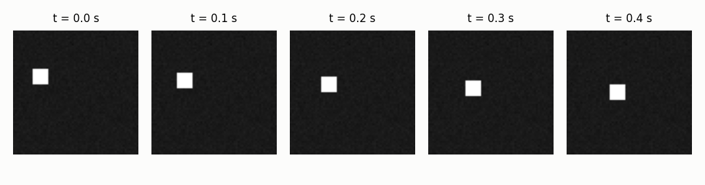
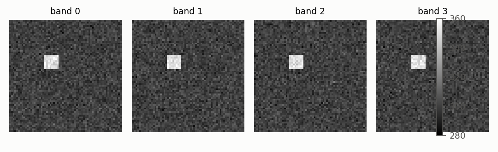

# Frames: the currency of every video

Every video source, from a USB camera to a folder of images to a file
on disk, produces the same object: a frame with an image and the time
it was taken. The rest of the library only ever sees that object.

## 1. A frame is an image and a timestamp

A video is a sequence of images in time. The library takes the image
and the time together in one object, `Frame`, so that every step after
the reader can ask *when* as well as *what*.

```python
import numpy as np
from dense_armor.utility.vision import ArrayStream

frames = np.zeros((5, 120, 160), dtype=np.float32)
stream = ArrayStream(frames, fps=30.0)
for frame in stream:
    print(frame.array.shape, round(frame.t, 4))
```

```
(120, 160) 0.0
(120, 160) 0.0333
(120, 160) 0.0667
(120, 160) 0.1
(120, 160) 0.1333
```

`Frame.array` is a numpy array of floats in `[0, 1]`, `Frame.t` is
the time in seconds. The first frame is at time zero, the next one at
`1 / 30` of a second, and so on. The image never leaves the array, and
the time travels with it.

The same object comes from every source. `ArrayStream` reads frames
already in memory, which is what the tests use.
`CameraStream(device=0)` reads a real camera through OpenCV. If OpenCV
is not installed the constructor raises a clear `ImportError`, and the
extra installs it with `pip install dense-armor[vision]`.
`ImageFolderStream(path)` reads a folder of images in name order,
using Pillow, which matplotlib already brings.



## 2. A file or a URL, not just an array

A recording lives in a file, and the file may be large. A reader that
loads it all into memory at once does not scale.

```python
import pathlib, tempfile
import numpy as np
from dense_armor.utility.vision.streams import VideoFileStream

path = pathlib.Path(tempfile.mkdtemp()) / "clip.mp4"
try:
    import cv2
    writer = cv2.VideoWriter(
        str(path), cv2.VideoWriter_fourcc(*"mp4v"), 10.0, (8, 8))
    for i in range(5):
        writer.write(np.full((8, 8, 3), i * 50, dtype=np.uint8))
    writer.release()
    for frame in VideoFileStream(str(path)):
        print(round(frame.t, 2))
except ImportError:
    print("OpenCV missing; install dense-armor[vision]")
```

```
0.0
0.1
0.2
0.3
0.4
```

`VideoFileStream` reads a file, a glob of files, a URL, an RTSP
stream, or a file that is growing while it is read. The time of each
frame is the container's own clock, not `index / fps`: a recording
whose frame rate changes with time keeps the true time of every frame.
`start`, `stop`, `stride` and `max_frames` trim the stream; `state_dict`
and `load_state_dict` let the reader resume from where it stopped. A
file that cannot be read raises a clear error, never a crash inside the
decoder.

## 3. A cube of channels, not just RGB

A thermal camera, a depth sensor, a multispectral stack give an image
with a channel count that is not three. The frame keeps every channel
of every frame, in the sensor's own units.

```python
import numpy as np
from dense_armor.utility.vision.streams import CubeStream

cube = np.zeros((1, 64, 64, 4), dtype=np.float32)
cube[0, :, :, :] = 300.0
cube[0, 20:28, 20:28, :] = 350.0
stream = CubeStream(cube, fps=30.0, gray=False)
frame = next(iter(stream))
print(frame.array.shape, float(frame.array[24, 24, 0]))
```

```
(64, 64, 4) 350.0
```

Four bands, a hot square at value 350 and a background at value 300.
`CubeStream` accepts one channel, four channels, or a hyperspectral
stack. A 16-bit cube keeps every value of the sensor without loss, so
a thermal readout at 12-bit is not degraded by an 8-bit conversion.



## Details

### References

The image loaders are not algorithms with a paper. `VideoFileStream`
and `CameraStream` read through OpenCV; `ImageFolderStream` reads
through Pillow. Both are optional dependencies of the library: OpenCV
via `dense-armor[vision]`, Pillow via matplotlib's own dependencies.

### Choices stated explicitly

- `Frame` is a numpy array and a timestamp, nothing more. Every
  feature, every detector, every writer down the chain works on a
  `Frame` regardless of which reader produced it.
- `VideoFileStream` reads the time from the container, never from
  `index / fps`. `CubeStream` has no clock of its own, so its time is
  `index / fps` as the docstring says.
- `CubeStream` truncates a 4-channel frame to 3 only when `gray=True`
  or `bgr=True`. When both are `False`, every channel is kept. This
  was a defect in the first version of `_to_dtype`; the fix is in
  commit `015fd15` and a test checks the four-channel case.
- `CameraStream` opens the device with `bgr=True`: OpenCV delivers
  BGR, and the library turns it into RGB before the grey conversion.

### Measured cost

`CubeStream` and `ArrayStream` iterate at the rate of the underlying
numpy slice: no copy per frame. `VideoFileStream` calls OpenCV once
per frame, and the cost is inside OpenCV.

### The numbers in this page

The five timestamps of Section 1 are printed by the code block on a
5-frame array at 30 fps. The five timestamps of Section 2 are printed
by the same code block on a 5-frame file written on the fly, if OpenCV
is installed. The `(64, 64, 4) 350.0` of Section 3 is printed by the
third code block on a 4-band cube of 64 by 64, background 300, hot
square 350. Figures: `docs/assets/vision/make_figures.py`,
`fig_01_frames` and `fig_02_thermal`. The figure script prints the
five timestamps and the mean of the hot square per band
(`fig01_times`, `fig02_shape`, `fig02_hot_mean` in `figures.json`).
