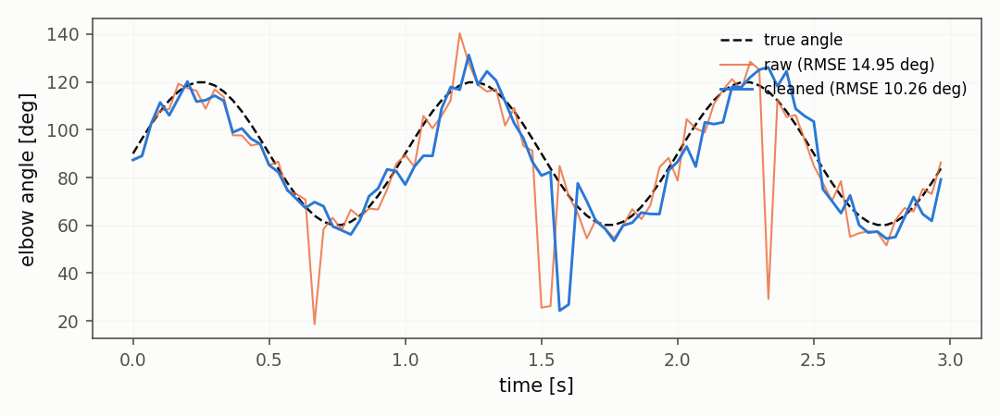

# Landmarks, kinematics, registration

## Landmarks and kinematics

An external pose source (a marker system, a network, the joints of a
robot seen by a camera) delivers points over time. The
`LandmarkStream` is the
interface, `LandmarkCleaner`
filters them with a causal Hampel, and
`Kinematics` turns them into
angles, speeds and a cycle residual that the drift detectors understand.
On 20 synthetic seeds the cleaned series has a smaller error than the
raw one on every seed (Wilcoxon two-sided, A12 = 1.0).

## Registration and difference imaging

When the camera moves, the difference between two frames is dominated
by the global shift. `Registration`
estimates the shift with phase correlation, `Stabilizer`
removes it, and `DifferenceImage`
shows what really changed. On a pure translation the shift is exact
(0.0 px error on 20 seeds). The kernel convolution of Alard and Lupton
(1998) is not implemented here; the difference is noted in the module
docstring.

## Details

See the class docstrings in `dense_armor/utility/vision/` and the guide in the sections above.
