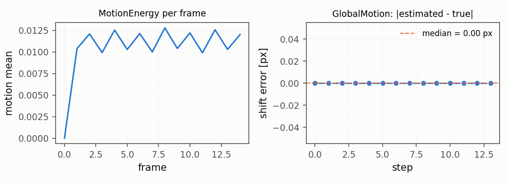
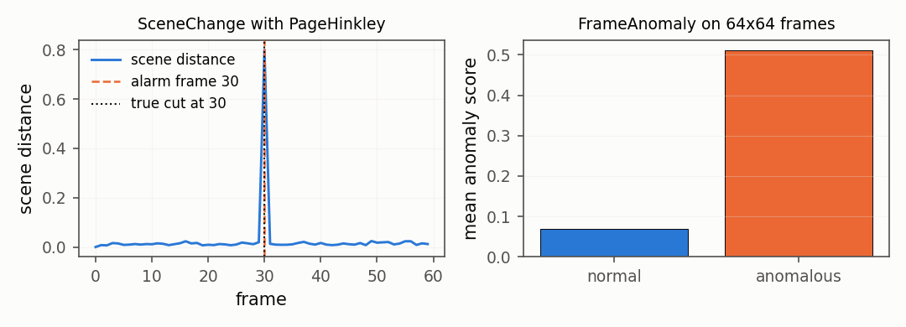

# Motion in time: energy, global shift, scene changes

## Motion in time

Two frames in a row carry the movement that a single frame does not.
`MotionEnergy` measures the
amount of change (a filtered difference, summarised per frame) and
`GlobalMotion` estimates the
*global* shift of the scene with phase correlation, which separates the
motion of the camera from the motion of the objects. On a pure
translation the shift is exact to the tenth of a pixel.

## Scene changes and temporal anomalies

A hard cut in a video is a level shift in the difference between
consecutive frames, which is what a drift detector for a scalar stream
was built for. `SceneChange`
turns a frame into a scalar distance (histogram distance plus mean
absolute difference) and feeds it to a
`ADWIN` or to any other drift
detector of the library. `FrameAnomaly`
scores a frame against a memory of the patches the library has already
seen, following the PatchCore idea.

## Sliding window

`FrameWindow` keeps the last
``n`` frames, or the last ``s`` seconds, in a ring buffer, and
summarises them with streaming mean, standard deviation, motion energy
and quantiles of the DDSketch sketch. The memory is ``O(n)``, so a
stream of any length keeps the same footprint.

### API

- [`MotionEnergy`](../api/general.md#motionenergy)
- [`GlobalMotion`](../api/general.md#globalmotion)
- [`SceneChange`](../api/general.md#scenechange)
- [`FrameAnomaly`](../api/general.md#frameanomaly)
- [`FrameWindow`](../api/general.md#framewindow)
