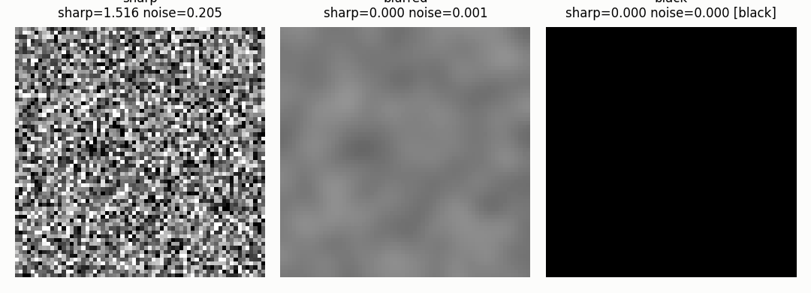

# Quality, event cameras, visualisation, benchmark

## Frame quality, sync and event cameras

`FrameQuality` measures the
sharpness, the exposure, the noise and two flags (a black frame, a
frame repeated from the previous one).
`Sync` estimates the clock
offset between two streams by cross-correlating their features (2.9 ms
error on 20 seeds against a uniform offset in [-50, +50] ms).
`EventFrame` accumulates an
asynchronous event stream into a frame with the polarity sign.

## Visualisation

`FalseColor` brings any
band (thermal, depth, NIR, UV, SAR) into a visible image with a
colormap; `Overlay` draws
the tracks, the mask, the flow and the score on a frame;
`VideoWriter` writes the
annotated video and one summary image with the signals in time.

## Benchmark

``benchmarks/video_quality.py`` measures every module above at 640x360
on three synthetic streams (a smooth motion, a sudden cut, a
multi-channel thermal sequence). The JSON next to the script carries
the numbers and the machine. The 1280x720 and 1920x1080 runs exceed
the free Colab session, and are reported as not measured.

## Details

See the class docstrings in `dense_armor/utility/vision/` and the guide in the sections above.
