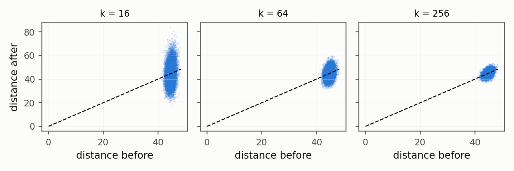
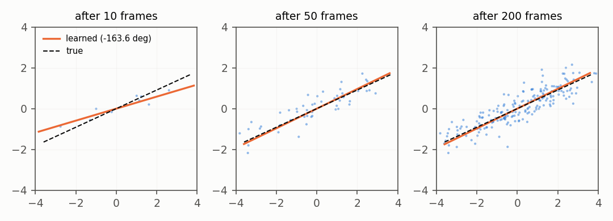
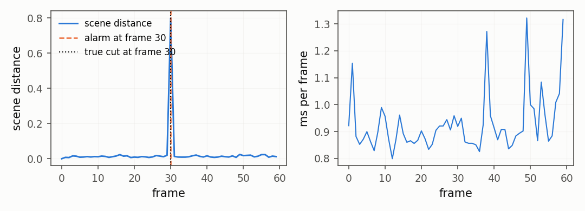

# Fewer numbers, same meaning: projection, PCA, the whole chain

## 5. Fewer numbers, same distances: random projection

Multiplying by a fixed random matrix shrinks a vector from 256 numbers to
64 while keeping the distances between frames almost the same. This is the
Johnson–Lindenstrauss lemma.

```python
import numpy as np
from dense_armor.utility.vision import RandomProjection

rng = np.random.default_rng(0)
d, n, k = 256, 100, 64
X = rng.standard_normal((n, d))
rp = RandomProjection(k=k, seed=0)
keys = [f"f{i:03d}" for i in range(d)]
Y = np.array([list(rp.transform_one(dict(zip(keys, row))).values()) for row in X])
r = [np.sum((Y[i] - Y[j]) ** 2) / np.sum((X[i] - X[j]) ** 2) for i in range(n) for j in range(i + 1, n)]
print(round(float(np.median(r)), 3), round(float(np.mean((np.array(r) < 0.5) | (np.array(r) > 1.5))), 4))
```

```
0.975 0.0024
```

Two hundred fifty-six numbers per frame become sixty-four, a factor of
four fewer. The median ratio of the squared distances between two frames
before and after the projection is 0.975, close to 1: a pair of frames that
was far apart in the original space stays far apart, and a pair that was
close stays close. The fraction of pairs off by more than fifty per cent
is 0.0024, well below the theoretical limit.

The projection matrix is a dense Gaussian matrix with variance `1 / k`, the
one used in the proof of the lemma. The bound for a single pair of points
is equation (21) of Ghojogh et al. (2021):

$$P\big((1-\epsilon)\|x_i - x_j\|^2 \le \|f(x_i) - f(x_j)\|^2 \le (1+\epsilon)\|x_i - x_j\|^2\big)
\ge 1 - \delta, \qquad \delta = 2\,e^{-(\epsilon^2 - \epsilon^3)\,k/4}$$

With `k = 64` and `ε = 0.5`, a single pair of points is off by more than
fifty per cent with probability at most `δ = 0.27` in the worst case. The
experiment above is on `n = 100` independent points and the fraction of bad
pairs is well below that, because `δ` is a worst-case bound, not a tight
estimate.

The lemma is counter-intuitive on purpose. It says that if all you care
about is the distances between points, you can throw away most of the
coordinates, as long as you throw them away in a random direction. The
proof in Ghojogh et al. (2021) follows the classical steps: one pair of
points first, then a union bound over all the pairs.
The consequence for the library is practical: a single matrix drawn once
with a seed keeps the geometry of the data good enough, and never needs to
be retrained.



## 6. Learning the main directions: incremental PCA

Principal component analysis finds the directions along which the data
varies most. The incremental version learns them one sample at a time,
without ever storing the whole dataset.

```python
import numpy as np
from dense_armor.utility.vision import IncrementalPCA

rng = np.random.default_rng(0)
pca = IncrementalPCA(k=1)
for _ in range(400):
    pca.learn_one({"a": float(rng.normal(0, 0.1)), "b": float(rng.normal(0, 1))})
v = pca.components_[:, 0]
print(round(float(np.degrees(np.arccos(abs(v[1]) / np.linalg.norm(v)))), 2))
```

```
1.08
```

The stream has two channels: `b` varies ten times more than `a`. After 400
samples the learned direction is within 1.08 degrees of `b`, the true top
direction. The library found the right axis without ever keeping more than
two floats of state for the component.

The update is a stochastic power iteration with orthonormalisation, the
same rule as the one-component Oja update in Balsubramani, Dasgupta,
Freund (2013), equation (1):

$$v_n = v_{n-1} + \gamma_n\big(X_n X_n^\top - (v_{n-1}^\top X_n X_n^\top v_{n-1})\, I\big)\, v_{n-1},
\qquad \gamma_n = c / n$$

The running mean is removed from each sample before the update, and the
component matrix is re-orthonormalised after every sample, so the `k`
components stay orthogonal to each other. The paper analyses the rate of
convergence: the potential `1 - (v · v*)^2 / |v|^2` goes to zero as
`O(1 / n)` when the constant `c` is at least
`1 / (2 (λ_1 - λ_2))`, where `λ_1` and `λ_2` are the two top eigenvalues
of the covariance.

The word "incremental" is the whole point. Classical PCA, from Pearson in
1901, needs the whole dataset in memory and does an eigen-decomposition of
the covariance matrix; for the 256 features of this page that would be a
256-by-256 matrix filled by a hundred frames. The incremental version keeps
a fixed `d × k` matrix and updates it in place. It has seen a hundred
thousand frames, or a million, and its state is still the same size: a
matrix and a mean. On a robot, that is the difference between a component
that runs for a shift and a component that has to be restarted every hour.



## 7. The whole chain: a camera that notices a change

Three steps joined with `|`. Every step learns as the frames go by; the
anomaly score is read before the frame is fed to the chain.

```python
import numpy as np
from dense_armor.utility.anomaly.mahalanobis import OnlineRobustMahalanobis
from dense_armor.utility.vision import ArrayStream, FrameFeatures, IncrementalPCA

frames = []
for i in range(100):
    f = np.zeros((32, 32), dtype=np.float32)
    if i < 80:
        f[8:16, min(24, 4 + i // 4):min(24, 4 + i // 4) + 8] = 1.0
    else:
        f[8:20, 8:20] = 1.0
        f[24:30, 24:30] = 0.8
    frames.append(f)
pipe = FrameFeatures() | IncrementalPCA(k=4) | OnlineRobustMahalanobis(feature_keys=[f"pc{j}" for j in range(4)])
scores = []
for fr in ArrayStream(np.stack(frames), fps=10.0):
    scores.append(pipe.steps[-1][1].score_one(pipe.steps[1][1].transform_one(pipe.steps[0][1].transform_one(fr))))
    pipe.learn_one(fr, t=fr.t)
print(round(float(np.mean(scores[20:80])), 3), round(float(np.mean(scores[80:])), 3))
```

```
2.998 4.439
```

For the first 80 frames a small bright square slides across the scene. From
frame 80 the scene changes: the square grows and a second object appears.
The mean anomaly score rises from 2.998 to 4.439. The library has learned
what "normal" looks like from the streaming frames alone, without a
pretrained model and without storing a single frame after processing it.

The way to read this chain is the same way as the rest of the library.
Each `|` passes the output of one step to the input of the next. The first
step turns a frame into a hundred and thirty numbers. The second step
compresses those into four. The third step measures how far the four
numbers sit from the running centre of mass of the previous ones; a large
distance means the frame does not look like the ones the library has seen,
and the robot has a signal to react to. The third step is the online
robust Mahalanobis distance from Guillot et al. (arXiv:2601.03957), which uses the
geometric median and the median covariation matrix of the projected
features; Cardot, Cénac and Zitt (2013) and Cardot and Godichon-Baggioni
(2017) prove the averaged stochastic gradient updates that keep both up
to date.

Nothing in the chain was trained in advance. No labelled data, no
pretrained weights, no external service was called. The library saw a
square move for eighty frames and then noticed, on its own, that the
scene had changed.



## 8. Fast enough for a control loop

Measured on the development machine, 160×120 frames, median and 99th
percentile over 95 frames:

| step | p50 (ms) | p99 (ms) |
|---|---|---|
| `FrameFeatures` | 1.76 | 2.05 |
| `FrameFeatures` + `IncrementalPCA(k=8)` + Mahalanobis | 2.05 | 3.02 |

A camera at 30 frames per second leaves 33 milliseconds per frame. Even at
the 99th percentile, the full chain is well inside that budget: there is
room left for the rest of the control loop.

The reason the numbers are this small is that everything runs in numpy on
the CPU. There is no GPU, no separate process, no network call to a
pretrained model. On the development machine the whole chain uses less
than a tenth of the 33 ms frame budget at 30 frames per second.

### API

- [`RandomProjection`](../api/general.md#randomprojection)
- [`IncrementalPCA`](../api/general.md#incrementalpca)
