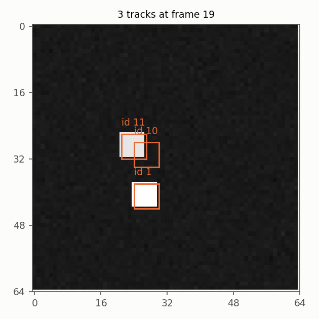

# Tracking: objects, signals, joints

## Tracking without a detector

`MovingObjectTracker`
builds a running robust background, groups the changed pixels into
connected components, and follows every component with a Kalman filter.
The association is two-round, high confidence first and low confidence
second, the idea of ByteTrack. The same class accepts boxes from an
external detector with ``update(boxes)``.

## Video to signal, joints to video

`TrackToSignal` and
`FeatureToSignal` turn a
track or a dict of features into a
`Signal`, so the drift detectors, the anomaly
detectors and the metrics of the library work on video without any new
code. `FrameJointFusion`
aligns the video with the joint readings and estimates the latency of
the camera by correlating the motion in the video with the joint speed,
within the frame rate of the source.

## Details

See the class docstrings in `dense_armor/utility/vision/` and the guide in the sections above.
